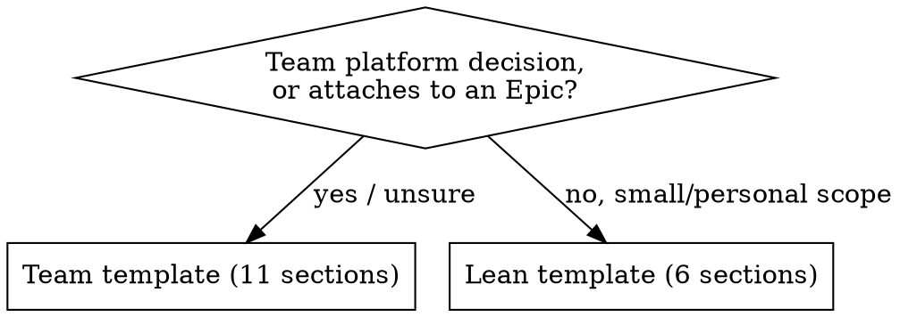

# Writing ADRs

## Overview

An ADR records a decision and its rationale for the people who build and
maintain the platform. State the what and why, not the how. Implementation
belongs in follow-up work items, not the ADR.

## When to use

- Drafting a new ADR for a substantive decision.
- Reviewing an ADR draft for format and writing style.
- Superseding or deprecating an existing ADR.

Not for designing the architecture or evaluating options from scratch, that
is `architecture-designer`. This skill writes up a decision already in view.

## Pick the format



- Team template: `references/team-template.md`
- Lean template: `references/lean-template.md`

## Location and naming

- Live in `Work/<project>/adrs/` in the vault (canonical, indexed). Find the
  existing project folder with a glob on `Work/*/adrs/`.
- Filename `YYYY-MM-DD-slug.md`, date-prefixed. Not number-prefixed.
- Title line `# ADR - 00XX - Title`. The number stays `00XX` until the
  decision is accepted and a number is assigned.

## Frontmatter (required, Obsidian)

```yaml
---
type: decision
date: YYYY-MM-DD
domain: work
project: <project>   # the Work/<project>/ folder name
status: proposed   # proposed | accepted | superseded | deprecated
tags: [adr, ...]
---
```

Follow it with a Revision table: Date, Version, Note, Author.

## Writing rules

**REQUIRED: follow the `doc-standards` skill for prose.** ADR-specific rules
on top of it:

- What and why, not how. Implementation goes to follow-up epics.
- Proposals, not conclusions. "The platform should", not "must" or "the only
  way".
- Acknowledge the current state without implying it is wrong. The audience
  built it.
- Separate aspiration from assessment. A future-state description is not
  criticism of the present.
- **No em dashes.** Use a period, a comma, or restructure. This is the rule
  most often slipped.
- Tables and code blocks over long prose. As much as necessary, as little as
  possible. Small examples for illustration only, do not mirror code.
- Obsidian native: cross-reference with wikilinks `[[note]]`, not bare paths.
  **REQUIRED: use the `obsidian:obsidian-markdown` skill.**

## In the cc-spex loop

The ADR sits between brainstorm and specify. It is the input to
`/speckit-specify`, not an output of plan.

- Source: the agreed approach in the brainstorm document. Carry its
  alternatives into "alternatives considered"; do not reopen them.
- Decision section: concrete enough to specify from. If an ADR holds several
  decisions, label them (Decision A, B) so a spec can take one.
- Link the brainstorm document and the Jira keys the decision serves.
- The spec's `**Input**` line cites the ADR by date and title, plus the
  decision label when there is more than one.
- If implementation later contradicts the decision, supersede the ADR and
  run `/speckit-spex-evolve`; never edit an accepted decision in place.

## Reviewing an ADR

Cross-check every claim against the other sections of the same document.
Contradictions are the highest-priority finding. Propose changes in text
first, edit only after approval.
